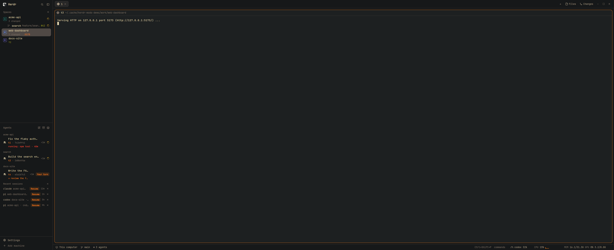
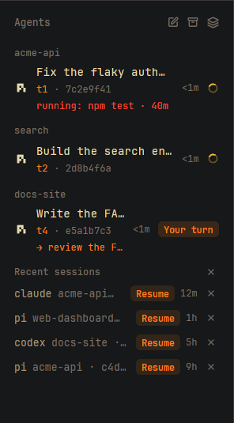
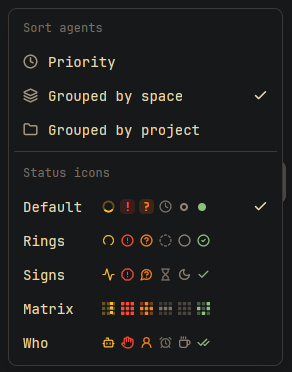
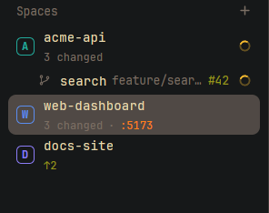

# herdr-mods

Six mods for the [Herdr desktop app](https://herdr.dev) (herdr-app) that put more of what you need
in front of you: which session each coding agent is running and what it's doing right now, what changed
in each space, how its CI is doing, how busy the machine is, how much of your AI quota is left, a
search over every past session, and the markdown files an agent just wrote, one key away.



| Mod | What it adds |
|---|---|
| [**agents-ids**](agents-ids/RECIPE.md) | A second line under every agent: terminal address and short session ID (Ctrl-click to copy). *Grouped by project* in the sort menu puts agents of one git repo together, worktrees included. A finished agent shows its reply's **Next** line, sorts with *Needs you* when that line asks for you, and reads *Waiting* while a background job will wake it. **Herds:** agents started by a lead nest under it in Priority view, with a summary and each worker's brief. **Send to several:** pick agents, type once. A third line with what the agent is doing now (`running: terminal npm · 4m`), running as a ticker on hover when it is too long, amber when it has been working on the same thing for over 30 minutes; then, or after 5 minutes blocked, one notification with a sound, which focuses the agent when clicked. An X on each row checks what closing would lose (still working, uncommitted changes, sub-agents) before it ends the terminal. *Recent sessions* below, with **Resume** for agents that ended. **Save & close sessions** saves every agent's session and closes the tabs that are safe to close (not working, not waiting for an answer, no build or test running); **Reopen** brings them back in their spaces. Five status icon sets in the sort menu (Default, Rings, Signs, Matrix, Who). Claude Code, Codex, Pi, PiG, OpenCode and Hermes, or any agent that sets one label. |
| [**spaces-plus**](spaces-plus/RECIPE.md) | Git changes, tab count and agent status per space, the active space's tabs, the ports its programs listen on and its branch's pull request (click to open; red when a check failed, amber when CI has sat queued over 45 minutes), CPU and memory per machine, why a machine is unreachable and since when, recent spaces to reopen. |
| [**sysstat**](sysstat/RECIPE.md) | CPU with a one-minute sparkline, memory and AMD GPU in the status bar, for the machine of the space you're looking at. Click for `btop`. |
| [**sessions**](sessions/RECIPE.md) | A search box over past Hermes, Pi and PiG sessions (title, folder, matching text); Enter resumes the picked one in a new tab. |
| [**usage**](usage/RECIPE.md) | The busiest AI provider quota in the status bar behind a gauge icon (`codex 31%`, red from 90%), every provider and its reset time on hover. Reads JSON from a command you set ([Kuota](https://github.com/DarkoKuzmanovic/kuota)'s collector format). |
| [**md-open**](md-open/RECIPE.md) | Lists the markdown, HTML and PDF files named in the focused terminal (plans, reports an agent just wrote), newest first; Enter opens markdown in [`fresh`](https://github.com/sinelaw/fresh) in a split to the right, HTML and PDF in your browser or PDF viewer. |
| [**copy-on-select**](copy-on-select/RECIPE.md) | Shift-drag a selection in any terminal and it's copied once the pointer settles, with a *Copied* toast. Plain drags copy nothing. Linux-friendly: no OS helper. |

<p>
  
  
  
</p>

What changed between versions: [CHANGELOG.md](CHANGELOG.md).

## Install

```sh
git clone https://github.com/DarkoKuzmanovic/herdr-mods ~/code/herdr-mods
cd ~/code/herdr-mods
./install.sh               # mods + session-ID hooks for the agents you have
./install.sh --mods-only   # just the mods
herdr-app do layout.switch '{"name":"main-plus"}'
```

`install.sh` copies the mods into `~/.config/herdr-app/mods/` and adds a `main-plus` layout: Herdr's
`main` with the three mods in place. `Ctrl+Shift+L` switches back to your own layout. Re-run it after
`git pull`; it updates in place, adds each hook once, and moves anything of yours that's in the way to
`~/.cache/herdr-mods/backup-<time>/` instead of overwriting it.

herdr-app on Windows with the agents in WSL: run `install.sh` in WSL (the hooks belong there) and point
it at the Windows app's folder, which it can't find by itself:
`HERDR_APP_CONFIG=/mnt/c/Users/<you>/.config/herdr-app ./install.sh`. Then check the mods from Windows
with `herdr-app check`; the installer only checks with a `herdr-app` on WSL's PATH.

Prefer your own layout? Clone it and set `content.mod` of the `spaces` and `agents` blocks to
`spaces-plus` and `agents-ids`; add a `sysstat` block where you want the bar (it docks at the bottom by
itself the first time Herdr sees it).

`sessions` opens as a dialog; bind a key to it in `~/.config/herdr-app/keys.json` (the installer
doesn't touch your keys): `"ctrl-shift-s": "mod.open:sessions"`. `md-open` the same way, e.g.
`"alt-o": "mod.open:md-open"`. `agents-ids`' Save & close sessions and Reopen are key commands:
`"ctrl-shift-u": "agents-ids.unload"`, `"ctrl-shift-alt-u": "agents-ids.load"`; `agents-ids.sort` opens the sort menu.

`usage` shows nothing until you give it a command in its layout block's props:

```json
{ "id": "usage", "type": "block", "size": { "px": 130 },
  "content": { "mod": "usage", "props": { "command": ["node", "/path/to/kuota/collector/cli.js"], "every": 300, "on": "other-machine" } } }
```

`command` is an argument list (no shell), `every` is seconds between runs (default 300), and `on` runs
it on another herdr-app machine (default: this one). The command must print `{"providers": [{"id",
"state", "windows": [{"label", "usedPercent", "resetAt"}]}]}`.

Asking an agent instead? Point it at a mod's folder on GitHub (or its page on
[herdr.dev/mods](https://herdr.dev/mods)); herdr-app's own `AGENTS.md` tells it how to add a shared mod,
and each `RECIPE.md` is the brief to rebuild one from scratch. Each mod is one folder in herdr.dev's
shape: `<name>/RECIPE.md`, `<name>/preview.png` and the mod itself in `<name>/mods/<name>/`.

## Session IDs: how agents report them

`agents-ids` reads two terminal labels: `agent.session` (the session ID) and `agent.app` (the program,
so Resume knows the command). Anything running in a herdr-app terminal can set them:

```sh
hc label "$HC_TERMINAL_ID" agent.session=<session-id> agent.app=claude
```

`integrations/` does this for you (`./install.sh` sets up the ones whose config folder exists):

| Agent | Hook | ID shows up |
|---|---|---|
| Claude Code | `SessionStart` hook in `~/.claude/settings.json` | at start |
| Codex | `SessionStart` hook in `~/.codex/hooks.json` (needs `hooks = true` under `[features]`) | after the first prompt |
| Pi, PiG | extension `agent-session.ts` in `~/.pi/agent/extensions/`, `~/.pig/agent/extensions/` | at start |
| OpenCode | TUI plugin `agent-session-label/`, listed under `plugins` in `~/.config/opencode/cli.json` | after the first prompt |
| Hermes | plugin `agent-session-label/` in `~/.hermes/plugins/` (then `hermes plugins enable agent-session-label`), or without a clone: `hermes plugins install DarkoKuzmanovic/herdr-mods/integrations/hermes/agent-session-label --enable` | at the first turn |
| Anything else | call `agent-session-label <id> - <app>` from its session-start hook | |

All of them call [`integrations/bin/agent-session-label`](integrations/bin/agent-session-label), linked
into `~/.local/bin`. It labels only when the agent is the terminal's foreground program, so an agent
that another agent starts in the background (`claude -p` from a script) can't overwrite the ID you see.
Outside herdr-app it does nothing, and it never makes a hook fail. It reads `/proc` on Linux and falls
back to `ps` elsewhere (macOS: written for, not yet tried).

Resume runs `claude --resume <id>`, `codex resume <id>`, `pi --session <id>` (PiG: `pig`),
`opencode --session <id>` or `hermes --resume <id>`, and only for IDs made of letters, digits, `-`, `_`
and `.`. It opens a new tab on the session's own machine, in its space and folder when those still exist.

Hermes and Pi/PiG also set `agent.doing` (a short plain line: `thinking`, `running: <tool> [git|npm|…]`,
`waiting for you`, `done`; never command arguments or paths) and `agent.doing.since` (epoch seconds of
the last change). Any agent can set them the same way; `agents-ids` shows them as the third line.

Every label the mods read, who sets it and what shows it: [docs/labels.md](docs/labels.md). None is
required: a feature whose label is missing shows nothing. The Hermes plugin also reports Hermes's turn
state to Herdr (working, done, blocked on a question), the reply's `Next:` line (`agent.next`, and
`agent.needs=you` when it asks for you) and background jobs that will wake the session (`agent.waiting`).
Under a shared Hermes gateway, pass the terminal through: `terminal.client_env_passthrough:
[HC_TERMINAL_ID, HC_TERMINAL_SOCKET]` in the profile's config.

To remove a hook, delete its line or file from the places above.

## Develop

```sh
./install.sh --watch    # copy mods into herdr-app, then re-copy on every save
for m in agents-ids spaces-plus sysstat sessions usage md-open copy-on-select; do node $m/mods/$m/test_logic.mjs && herdr-app check $m/mods/$m; done
python3 -I tests/test_label.py && python3 -I tests/test_hermes_plugin.py && python3 -I tests/test_sessions_search.py && node tests/test_pi.mjs
scripts/demo.sh start   # screenshots from a demo window with its own herdr-core; then `shot`, `stop`
```

[AGENTS.md](AGENTS.md) has the rules for changing the repo (for coding agents and people alike):
where helpers go, the label contract, the checks, the changelog and how a release is made.

Edit in this checkout, not in `~/.config/herdr-app/mods/`: `--watch` overwrites the copies there. The
mods are copied rather than symlinked because herdr-app hot-reloads a mod only when a file in its own
folder changes, and an edit behind a symlink never reaches that folder.

`agents-ids` and `spaces-plus` are copies of Herdr's shipped `agents` and `spaces`. The `upstream`
branch holds those shipped files unchanged, at the same paths. When a herdr-app update changes them:

```sh
git switch upstream
cp ~/.config/herdr-app/mods/agents/main.js agents-ids/mods/agents-ids/main.js
cp ~/.config/herdr-app/mods/spaces/main.js spaces-plus/mods/spaces-plus/main.js
git commit -am "Herdr's agents and spaces from herdr-app <version>"
git switch main && git merge upstream   # conflicts show exactly where Herdr and these mods both changed
```

## Requirements

herdr-app 0.1.12 or later, `git`, `rsync`, `python3`. Optional, each feature stays hidden without it:
`gh` (logged in) for pull request and CI badges, `ss` or `lsof` for ports, `btop`/`htop` for sysstat's click.
`sysstat` and the CPU/memory on machine rows read `/proc`, so they show Linux machines only.

## License

MIT, see [LICENSE](LICENSE). `agents-ids` and `spaces-plus` build on the `agents` and `spaces` mods
that ship with herdr-app (see the `upstream` branch).
