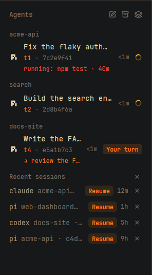

# Agents with IDs

Herdr's Agents list, with a second line under every agent: the terminal's address (`t3`) and the
agent's short session ID (`01a1a32c-c98e`). Ctrl-click the line to copy the session ID; Shift-click to copy
the address. Handy for `claude --resume`, `pi --session`, `codex resume`, `hc read t3` and for telling
two agents in the same folder apart. Below the agents, **Recent sessions** lists the agent sessions that
ended, each with a **Resume** button that reopens it.

**What you see:** the shipped `agents` mod unchanged (groups by status, sort menu, pins, sub-agents),
except each row is 44px tall instead of 30px and has two lines:

1. The agent icon, the space name, `· <tab title>` in the dim color, the age and the status mark, as in
   the shipped mod.
2. 11px text: the terminal address in the theme `accent` color, then `· <short session id>` in `dim`.
   Without a session ID only the address shows. A remote agent shows its address without the machine
   (`t5c`, not `laptop/t5c`): the machine is already named on the right.
3. When the agent sets `agent.doing`: what it is doing now and for how long (`running: git · 4m`), amber
   once it has been on the same thing for over 30 minutes. Then, or when the agent has been `blocked`
   for over 5 minutes, post one Herdr notification (`notify()`, warning, with `playSound("blocked")`)
   whose click runs `agent.focus` on it: once per stall (remembered in `localStorage`, also across
   restarts), again only when the doing line or the state changes and stalls anew.

An X on each agent row opens a check of what closing it would lose (still working, uncommitted changes,
sub-agents, and for a herd lead `Herd: N tabs still open (they keep running)`) before it ends the
terminal; it refuses if the terminal changed meanwhile.

**Next line and waiting** (labels in the repo's `docs/labels.md`): once an agent is done or idle, its third
line is `→ <agent.next>` (`dim`; `accent` when `agent.needs` is `you`), else `waiting: <agent.waiting> · 4m`,
else the `agent.doing` line. The row's status follows: `agent.needs=you` with a Next line is *asks*, a
`Your turn` pill (`accent`; `?` where the header says Needs you) sorted with Needs you; `agent.waiting` is
*waiting*, a clock icon in its own **Waiting** section after Working. A running or blocked agent always
shows Herdr's own status.

A third line too long for the row runs as a **ticker** while the pointer is on the row: after a second it
slides left at about 55 px/s, two copies 40 px apart, natively (`.transition("left")`; one timer per lap puts
a fresh element id back at 0, which looks the same). A mod can't measure text before drawing it, so the line
and text widths come from `on_mouse_move` bounds; the lap time reads them when it starts, not at the first
render. The line's own hover can't drive it (the sliding text ends it), so the row's does.

**Status icons**: below the sort choices the sort menu has a *Status icons* section, each choice previewed
with its six states: **Default** (the marks above), **Rings**, **Signs**, **Matrix** and **Who**, Lucide icons shipped in
`mods/agents-ids/icons/` (ISC, its `LICENSE` beside them) and listed in `ICON_SETS` in `extras.mjs`. The pick
is `shared("agents-ids.icons")`. The key command `agents-ids.sort` opens the menu (at the window's top left, as a key has no pointer to follow; the demo uses it for `docs/sort-menu.png`). A set replaces the spinner, the compact `!`/`?`, the clock, the ring and the
dot (12px, the status colors; the working icon spins in Rings; Matrix is a 3x3 grid of square dots, unlit ones at
25%, and while working a lit column sweeps across it, a `loop("left")` over the dim grid; Needs you
pulses every 900 ms and Waiting breathes every 2.4 s, a `loop("opacity")` down to 35%); the *Needs you* and *Your turn* pills stay.

**Herds**: a live terminal on this computer with `agent.lead=<t>` naming another live one is that lead's
herd member. A lead row gets a line `herd · 3 working · 1 needs you · 1 done`. In Priority view members
leave their own place and nest under the lead (one level, tree lines like sub-agents, folding with its
chevron), and the lead takes its most urgent member's section. Elsewhere members stay in their space or
project with a `↳ <lead>` chip that focuses the lead; a member whose lead is gone says `lead gone`. A member
with `agent.brief` shows the brief's short name (no date prefix or extension); a click opens it, markdown
in `fresh` in a split beside the member like md-open, anything else with `cx.open_url`.

**Send to several**: a pen icon left of the box icon turns picking on. Each row gets a check box and a click picks it
(never focusing or typing); a bar at the bottom says `To t5, t7`, holds an input and Cancel / `Send to N`
(Enter sends). Per picked agent: `hc read` its screen, find its input box (Hermes only for now: the last
line, `❯`, right under its status bar; anything else, such as a multi-line draft, counts as unreadable), and
`hc send` the text only when the box is empty. Someone typing in the few milliseconds between the read and
the send still joins the draft: herdr-core has no atomic send-if-empty. An unreadable box, unsent text
or a failed send skips it. One toast says where it went and why the rest didn't; the skipped stay picked.

The sort menu has a third choice, **Grouped by project**: one header per git repository, named after
the repo's folder, with its worktrees and subfolders under the main repo (`git rev-parse
--git-common-dir` on the terminal's machine, asked once per folder). A folder outside git is its own
group (`~/notes`). Rows name their space, since one project can span several; a remote project's header
starts with its machine (`vps: acme`).

**Recent sessions**, a foldable group after the others (header like the others, `Recent sessions n`):
   28px rows of the program name (`muted`), `<folder> · <short id>` (`dim`) and a `Resume` pill (10.5px
   semibold, `accent` text on a 12% tint of it), the age (`3h`, `dim`) and an X. Newest first; 5, then
   a `Show n more` row lists all remembered ones. An X on the header hides them all.

Short IDs: Hermes drops its `local-` prefix and shows 8 characters; UUIDv7 IDs (Pi, PiG, Codex) show 13
(their first 8 repeat for about a minute); OpenCode `ses_…` IDs show their last 8 (the random part);
anything else shows its first 8.

**How it behaves:** statuses (working, blocked, done, idle) look and sort exactly as in `agents`.
Hovering the second line shows the full address and session ID. Ctrl-click copies the session ID;
Shift-click copies the address; neither selects the row. A plain click selects the row as usual.
A session is *recent* when its terminal no longer runs it: the agent quit (the terminal is back at a
shell or runs something else) or the terminal closed. The mod remembers each labelled session it sees
(where, when) in `localStorage`, up to 20 for 14 days, so closed terminals and restarts don't lose
them; one that runs again anywhere leaves the list. **Resume** opens a new tab with the command as its
argv, on the session's own machine: in its space if that still exists (else another space there), in its
folder if that still exists. It never types into the old terminal, which may hold a half-typed line. Commands: `claude --resume`, `codex resume`, `pi --session`, `pig --session`, `opencode --session`,
`hermes --resume`. Ctrl-clicking the row copies the session ID; the X beside Resume hides the session
until it runs again.

**Save & close sessions**, the command `agents-ids.unload` (bind `ctrl-shift-u`; pressing it again closes
it) or the box icon (`workspace-chrome/archive.svg`, 13px, `dim`) left of the sort icon in the header, tooltip "Save & close sessions (Ctrl+Shift+U)":
a dialog (680x480, `popover`) of the same mod (`props: { unload: true }`; its overlay id kept in
`shared("agents-ids.unload")` so the key closes it, cleared in `close()`). One row per terminal whose agent is
Hermes, Claude Code, Codex, Pi, PiG or OpenCode, on every machine: `✓` (`done` color) or `⚠` (`blocked`),
`space / tab` (`machine: ` in front for a remote one), the program (`muted`), the folder's last part (`dim`),
the state at the right, and under a `⚠` the cause in `blocked`: `working: <agent.doing or mid-reply>`,
`waiting for your answer` (blocked), `runs: make ci-wait PR=1118 +1`, `same tab: t5 runs: npm run dev`,
`1 sub-agent running`, `checking processes…` (until asked), `couldn't check processes`. A click focuses the
agent (`agent.focus`). Buttons: **Save & close N safe** (primary, Enter), **Save & close all** (when a row is
`⚠`, first a "Close busy tabs too?" step listing them, Back or Esc returns), **Save only**. Esc closes. Each
writes every row to the snapshot, then runs `tab.close {id, confirmed: true}` on the tabs of `✓` rows (or of
all rows), and posts a toast "Saved 6 sessions · Closed 2 tabs · 4 still open". Nothing closes when the
write fails.

The process check is `procs.py` (python3 stdlib, read-only `/proc`), run once per machine with
`exec("python3", ["-c", script, ...pids], { on })` like `names.py`, given each terminal's shell `pid` (from
`terminals()`) for the agents and the other terminals in their tabs. Per shell it reports `fg` (the
foreground job leader, `tpgid`, unless the shell itself) and `runs`: processes of the terminal except the
shell, the agent and its helpers. The terminal's processes are the shell's descendants plus any process with
the shell's `HC_TERMINAL_ID` and `HC_TERMINAL_SOCKET` (Hermes runs its tool jobs under a separate backend
process), but not one whose topmost such ancestor was handed to init/systemd (a browser opened from the
agent outlives the tab). Helpers: whatever started within 60 s of the agent (TUI runtime, MCP servers) and
their children, and language servers. Each busy subtree shows its first non-shell program, shortened to 60
characters (an inline `python3 -c` script shows as `…`).

The snapshot is JSON at `~/.local/state/herdr-mods/session-snapshot.json` on this computer (with another
`$HERDR_APP_HOME`, such as the demo window's, `<app home>/data/herdr-mods/` instead): `saved_at` (ISO) and
per row `machine`, `space`, `space_name`, `tab_name` (null for an automatic number), `folder`, `app`,
`session`, `address`, `argv` (`resumeArgv`) and `resumable`. The session is the `agent.session` label, else
the id after the resume flag in the agent's own argv (an agent reopened by Reopen may label itself only
after its first turn).

**Reopen**, the command `agents-ids.load` (bind `ctrl-shift-alt-u`) or a bar at the top of the list,
"Reopen N sessions (saved HH:MM)" (`accent` on a 12% tint, an X that hides it until the next save), shown
while the snapshot has resumable sessions not running now. For each row: skip it when its session runs (a
live agent's label, or the id in a terminal's foreground argv); fail it when its machine isn't ready in
`machines()`; else `tab.new {space, name, folder, argv}` in its space (by id, else by name, same machine;
folder only if `test -d` passes there), or `space.new {name, folder, argv, machine, tab}` when that space is
gone. Then one toast: "Reopened 4 · skipped 1 (already open) · failed 1 (laptop offline)". Reopening twice
opens nothing new.

**Built from:** a copy of the shipped `agents` mod (herdr-app 0.1.12). Its own logic is in
`extras.mjs` (pure: `shortSid`, `resumeArgv`, `rememberSessions`, `recentSessions`, `unloadRows`,
`snapshotOf`, `runningSids`, `reopenable`, `reopenSpace`, `reopenSummary`, `effStatus`, `thirdLine`,
`herds`, `herdSummary`, `briefName`, `inputBox`). In `main.js`: a map
from terminal address to `labels["agent.session"]` from `terminals()`; the second line in the row
render; `recentRow()` and `resume()` (`resumeSpace`, `exec("test", ["-d", cwd], { on })`, then
`run("tab.new", { space, folder, argv })`);
the sort popup opens `{ mod: "agents-ids" }`. The session ID comes from a terminal
label any program can set: `hc label $HC_TERMINAL_ID agent.session=<id>`. `agent.app` names the program for Resume. This repo's
`integrations/` sets both for Claude Code, Codex, Pi, PiG, OpenCode and Hermes; any other agent can
call the same script from its session-start hook.

**Watch out:**
- Herdr's `AgentInfo` has no session ID; the label is the only way in. Agents that set no label show
  just their address.
- An agent started by another agent (one agent running `claude -p`) must not overwrite the visible
  agent's label; `agent-session-label` only labels when the agent is the terminal's foreground job.
- Codex and OpenCode report their session after the first prompt, so a fresh one shows only its address.
- `terminals()` lists live terminals only; a closed terminal's session survives only because the mod
  remembered it.
- Agents save a session only once it has a message: Resume on one quit before its first prompt gets
  the agent's own "no session found".
- Labels are written by any program: Resume runs only IDs of letters, digits, `-`, `_`, `.`, for the
  known programs only, and always as an argv in a new tab (never typed into a terminal).
- A session resumes only on the machine that holds it: when no space of that machine is open here,
  Resume does nothing.
- The mod is a copy: when Herdr ships a new `agents`, merge it (see the repo's README).

**Done when:**
- `herdr-app check mods/agents-ids` passes and `node mods/agents-ids/test_logic.mjs` prints `ok`.
- `hc label <t> agent.session=test-1234567890` makes `<t> · test-123` appear under that agent within a
  second; Ctrl-clicking it puts `test-1234567890` on the clipboard.
- Quitting a labelled Claude Code moves it to Recent sessions; Resume there brings back the same
  conversation in a new tab of that space.
- Save & close lists a plain idle agent with `✓`; `sleep 600` started inside its terminal a minute after the
  agent turns it `⚠ runs: sleep 600`. Save only writes the file and closes nothing; Save & close N safe
  closes only the `✓` tabs; Reopen brings them back in their spaces with their tab names, and a second
  Reopen opens nothing.
- `hc label <t> 'agent.next=your go to merge' agent.needs=you` on a done agent moves it to Needs you with
  `Your turn`; `agent.waiting=gh` (and no needs) moves it to Waiting with a clock.
- `hc label <t2> agent.lead=<t1> agent.brief=/tmp/x/2026-11-12-fix.md`: in Priority, t2 nests under t1,
  t1 reads `herd · …`, the row shows `fix`; in Grouped by space t2 stays put with `↳ <t1's name>`.
- Picking a Hermes agent with an empty box and one with a typed draft, then sending: only the first gets
  the text; the second stays picked and the toast says `unsent text there`.
