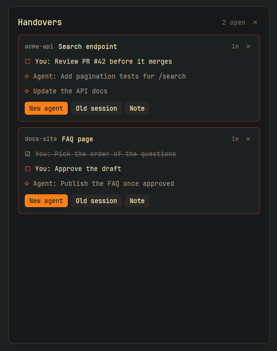

# Handovers

Build a Herdr mod that shows the handover notes agents leave in your repos: a status-bar badge and a
panel. A handover note is a markdown file, `<repo>/.hermes/plans/*-handover.md`, whose `## You` list is
the person's part and `## Agent` list the next session's; the format is in
[docs/handovers.md](../docs/handovers.md).

**Badge (a layout block in the status row, 112px):** theme `chrome` background with a 1px `border` line on
top, 14px side padding, 11.8px text, like its neighbours. A file icon and the count: `2`, or `2 · 1 yours`
in `blocked` when any note has an open `## You` item; `0` in `dim` when there are none. Hover highlights
it; the tooltip says what it holds and names the key. Click opens the panel (`run("mod.open", {name:
"handovers"})`).

**Panel (`mod.open:handovers`, a 480×620 `window` overlay, e.g. `ctrl-shift-h` in `keys.json`):** a
`Handovers` heading with the count and an X to close. One card per open note, your-turn notes first, then
newest. A card: the repo folder's name, the title, its age, and an X that marks the note done (hides it).
Then each `## You` item with a box (`☐` in `blocked`, `☑` in `done` with the text struck through);
clicking the item ticks or unticks it in the file. Then up to four `## Agent` items. Then three buttons:

- **New agent**: a new tab in the note's repo, named after the note, with a fresh agent (`app:` in the
  note, Hermes by default) whose first message asks it to read the note, sum up where things stand and what it would do next, and wait for a go.
  Hermes gets it as `hermes chat --tui -q <message>`; other agents through `tab.new`'s `task`.
- **Old session**: only when the note has a plain `session:` id (`^[\w.-]{4,128}$`): reopens that session in
  a new tab (`hermes --tui --resume <id>`, `claude --resume <id>`, …).
- **Note**: opens the note in `fresh` in a new tab.

Tabs open in a space whose folder is inside the note's repo, else the shown space on that machine.
Buttons and boxes stop the mouse-down so a press on them doesn't drag the window.

**How it finds notes:** for each machine with a space, `exec("python3", ["-c", handovers.py, "list",
...folders], {on: machine})` with every space's folder and every pane's folder there. The helper looks in
`.hermes/plans` of each folder and each folder above it below home, and returns the notes as JSON. The
badge looks every 60 s, the panel every 15 s, both at once when the folders change (a space opens, the
app has just loaded its spaces) or after the other copy changed a note (`shared("handovers.rev")`).
Ticks and done go through the same helper (`tick <file> <n>`, `done <file>`), which refuses any file
that isn't a handover note in a `.hermes/plans` folder, and drops the edit if the note changed since it
was read. Folders and paths travel as arguments, never as script; nothing is typed into a terminal.

Mod files: `mods/handovers/main.js`, `mod.json`, `logic.mjs`, `handovers.py`, `test_logic.mjs`.
Verify with `node handovers/mods/handovers/test_logic.mjs`, `python3 -I tests/test_handovers.py` and
`herdr-app check handovers/mods/handovers`.
