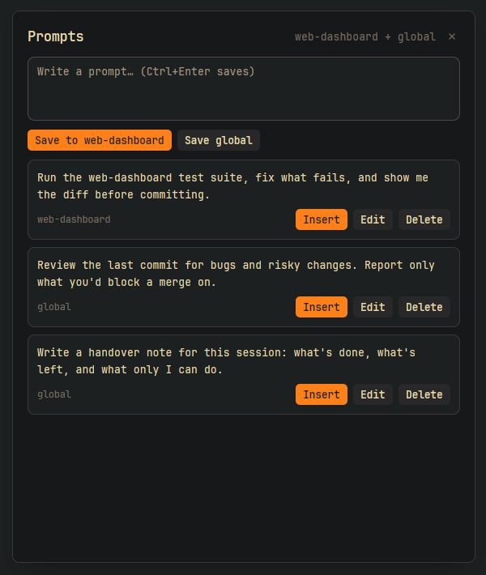

# Prompts

Build a Herdr mod that keeps prompts you want to send later: global ones, and ones for the project
the focused terminal is in. Open the panel, save or edit a prompt, and **Insert** it into the agent in
that terminal.

**Panel (`mod.open:prompts`, a 520×620 `window` overlay, e.g. `ctrl-shift-i` in `keys.json`):** a
`Prompts` heading with `<project> + global` (or `global`) and an X; Esc closes it too. Then a textarea
(3 to 10 rows) and two buttons: **Save to `<project>`** (primary; only when there is a project) and
**Save global**; Ctrl+Enter in the textarea saves to the project, or global without one. Then one card
per prompt, this project's first, then the global ones, newest first in each: the text (cut at 600
characters), its scope in `dim`, and three buttons:

- **Insert**: closes the panel, focuses the pane it was opened over, puts the prompt on the clipboard and
  runs `terminal.paste`. It is pasted, never sent: no Enter, so you can still change it. Only shown when
  a terminal was focused.
- **Edit**: loads the prompt into the textarea, its card outlined in `accent`; either Save button
  replaces it (and moves it to that scope). **Cancel edit** appears beside them.
- **Delete**: the first click turns it into **Delete?**, the second deletes.

**Project:** the git root of the focused terminal's folder (`git -C <cwd> rev-parse --show-toplevel`,
run on that terminal's machine), else the folder itself; for another machine's terminal it is
`<machine>:<path>`. Prompts saved elsewhere stay out of the list.

**Storage:** `~/.config/herdr-app/data/prompts.json` (under `appHome()`), an array of `{id, text, project,
at}`, `project` `""` for global. Read when the panel opens; written with `writeTextFile(path, text,
expected)` against the last read, so a save from another window is never overwritten (the panel says
so and reloads). Not `localStorage`: an overlay window's storage file is named by a hash.

Mod files: `mods/prompts/main.js`, `mod.json`, `logic.mjs` (pure: parse, filter, save, remove),
`test_logic.mjs`. Verify with `node prompts/mods/prompts/test_logic.mjs` and
`herdr-app check prompts/mods/prompts`.
