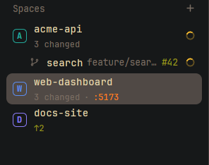

# Spaces Plus

Herdr's Spaces list, telling you more without opening anything: what changed in each space's repo, how
many tabs it has, which space has an agent working or waiting on you, and the active space's tabs right
under it. It also shows the ports a space's programs listen on and the pull request of its branch (click
either to open it), and how busy each machine is. Machines show how many spaces they hold, and an empty
machine offers its recently closed spaces back.

**What you see:** the shipped `spaces` mod (colored letter avatars, machines, worktrees under their
checkout, drag to reorder), with:

- **A second line** (11px, `dim`) when there is something to say: the repo name if it differs from the
  space name, the branch unless it's `main`/`master`, `↑n` (`ansi2`) and `↓n` (`ansi1`) ahead/behind,
  `n changed` (tracked changes, conflicts and untracked files), and `n tabs` when there are 2 or more.
  Without git it shows the folder (`~/…`) when there are 2 or more tabs. Rows with a second line are
  40px tall; others keep the shipped 30px.
- **Status on the right**, the space's most urgent agent: a `Needs you` pill (10.5px semibold, theme
  `blocked` color on a 15% tint of it) when blocked, the `workspace-chrome` spinner in `working` when
  working, a 7px `done` dot when done, nothing when idle.
- **The active space's tabs** under it (22px rows, indented 35px) when it has 2 or more: `1 · <title>`
  and `working 12m` / `needs you` / `done` in that status' color. Settled tabs fold into
  `› n tabs put away`; click to unfold.
- **Ports**, `:5173` chips in `accent` at the end of the second line (or after the branch on a worktree
  row): TCP ports that programs running in the space's folder listen on. Hover: program and address;
  click: opens `http://localhost:5173` (`http://<machine>:5173` for a remote space) in the browser. A
  WSL machine under the Windows app keeps `localhost` (WSL forwards it; its Herdr name resolves
  nowhere), told by `microsoft`/`WSL` in its `/proc/sys/kernel/osrelease`, read once per machine (no
  such file, as on macOS, means not WSL; only a failed read is tried again).
- **Pull request**, `#42` before the ports: the newest PR from the space's branch, green when open, `dim`
  when draft, `ansi5` when merged; closed-unmerged ones are left out. Red when a check failed, amber
  when CI has been queued for over 45 minutes; the tooltip names the failing checks. Click opens it on GitHub.
- **Machine rows** add the number of spaces, and CPU (`muted`) and memory (`dim`) in use (`12% 45%`, red from 90%) on
  connected machines; a remote without a reading yet shows a green `connected`. An unreachable machine
  shows why (`ssh timeout`, `connection refused`, `host key`) and since when, with the full error on hover.
- **Recent spaces** (up to 3, clock icon, `name · ~/folder`) under a machine with no spaces; click
  reopens one with `space.new`.
- An unnamed `~` space takes the name of the agent running in it (`pi`, `claude`).

**How it behaves:** click a space to switch, a tab row to select that tab; right-click and drag as in
`spaces`. Working times refresh every 30 s. Git is re-read when the space's folder changes. Ports are
read every 10 s per machine, from a constant script: `ss -ltnpH` plus each listener's `/proc/<pid>/cwd`
on Linux, `lsof` on macOS. A socket belongs to the space whose folder holds the program's folder most
closely (a worktree's server shows on the worktree, not on the checkout around it); home folders take
none; ports from 32768 up (private, ephemeral sockets) and the agents' own (`claude`, `codex`,
`opencode`, `pi`, `hermes`) are left out. Pull requests come from
`gh pr list --state all --json number,headRefName,state,isDraft,url,statusCheckRollup` per repo, at most
every 5 minutes, only for repos with a space on a branch other than `main`/`master`, after the ports (a
slow `gh` never holds up the port chips). Machine load reads `/proc/stat` and
`/proc/meminfo` every 4 s. With the window in the background: ports once a minute, load every 30 s. With the sidebar narrowed to
a rail nothing is polled: the rail shows none of it.

**Built from:** a copy of the shipped `spaces` mod (herdr-app 0.1.12). Its own helpers are in
`extras.mjs` (pure: `tilde`, `tabLabel`, `spaceName`, `changedCount`, `PORTS_SCRIPT`, `parseListeners`,
`assignPorts`, `portUrl`, `isWsl`, `prsByBranch`, CPU/memory parsing). Uses `exec("sh", ["-c", PORTS_SCRIPT], { on })`,
`exec("gh", …)`, `cx.open_url(url)` in the click handlers, `window()?.platform`, `readTextFile("/proc/…", { on })`,
`spaces()`, `machines()`, `panes()` (tab titles, agent names), `exec("git", ["status", "--porcelain=v2", "--branch"])`,
`readTextFile(appHome() + "/view.json")` for `recent` (no herdr function returns it), `run("tab.select")`,
`run("space.new")`, and icons from the shipped `workspace-chrome` mod (`spinner.svg`, `clock.svg`,
`chevron-right.svg`, `chevron-down.svg`).

**Watch out:**
- `recent` entries may have no `machine` field; those are treated as this computer's.
- Herdr keeps closed spaces in `recent` and has no command to drop one.
- The git count runs `git status` per space; a huge repo makes the line appear a moment later.
- No `gh`, or not logged in, or no GitHub remote: no badge, nothing else changes. Same for `ss`/`lsof`.
- `ss` sees only your own processes' pids, which is what a space runs anyway.
- A remote port bound to `127.0.0.1` there can't be opened from here; the tooltip shows the address.
- The WSL check can't tell a WSL instance on this computer from one on another PC (the mod knows no
  machine's host), so a WSL machine on another PC also gets `localhost` links, which point at this
  computer instead.
- The mod is a copy: when Herdr ships a new `spaces`, merge it (see the repo's README).

**Done when:**
- `herdr-app check mods/spaces-plus` passes and `node mods/spaces-plus/test_logic.mjs` prints `ok`.
- A space in a repo with one edited file shows `1 changed`; a second tab makes `2 tabs` appear and lists
  both tabs under the active space; `tab.settle` on one folds it into `1 tab put away`.
- An agent waiting for approval shows `Needs you` on its space.
- `python3 -m http.server 5173 --bind 127.0.0.1` in a space's folder shows `:5173` within 10 s; a
  worktree on a branch with an open PR shows its `#number`.
