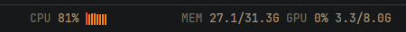

# CPU, memory and GPU

A slim status bar with the load of the machine you're looking at: CPU with a one-minute sparkline,
memory, and on AMD cards GPU load and VRAM, updated every 2 seconds:
`CPU 23% ▂▃▅▂▁  MEM 25.1/31.3G  GPU 12% 1.9/8.0G`. Click it for `btop`.

**What you see:** a 28px bar, theme `chrome` background with a 1px `border` line on top, 14px side
padding, 11.8px text: labels (`CPU`, `MEM`, `GPU`) in `dim`, values in `muted` (`blocked` from 90% busy or full). After the CPU value, a
sparkline of the last 30 readings: 2px bars, 1px apart, up to 14px tall, `accent`, `blocked` from 90%.
For a space on another machine the machine's name comes first, in `accent`. Before the first reading
values show `—`; if `/proc` can't be read, `CPU / MEM unavailable`. The GPU part shows only when an
amdgpu card is found. The bar highlights on hover, and resting on it (250 ms) opens a 300px card above it (`HoverCard`,
styled as the usage mod's): the machine, a 40px CPU graph of the last minute with average and peak,
then 4px bars for memory, GPU and VRAM (red from 90%), and "click: open btop in a new tab".

**How it behaves:** every 2000ms it reads `/proc/stat` and `/proc/meminfo` of the active space's machine
(`readTextFile(path, { on: space.machine })`, so a remote space's numbers come through herdr-core),
and on the first reading looks for `/sys/class/drm/card0..3/device/gpu_busy_percent`, then reads it with
`mem_info_vram_used` and `mem_info_vram_total`. CPU is the busy share (all but idle and iowait) since the
last reading; memory is `MemTotal − MemAvailable`. Switching to a space on another machine starts the
sparkline over. Click: `command -v btop || command -v htop || echo top` on that machine, then
`run("tab.new", { space, name: "monitor", argv: [that] })`.

**Built from:** one `View` (`h_flex`); `readTextFile`, `exec`, `run`, `spaces` and `theme()` from
`herdr`; `cx.timer.every`, `cx.spawn`. The parsing is in `logic.mjs` (pure, tested by
`test_logic.mjs`). `mod.json` docks it at the bottom (`"place": "bottom", "size": 28`); the repo's
`main-plus` layout puts it at the right of the status row, 420px wide.

**Watch out:** `/proc` and amdgpu sysfs are Linux-only; on macOS the bar says `CPU / MEM unavailable`.
NVIDIA and Intel GPUs aren't shown. Reads for a machine that is away fail quietly and show `—`.

**Done when:** `herdr-app check mods/sysstat` passes, `node mods/sysstat/test_logic.mjs` prints `ok`,
and the bar shows a CPU percentage within 4 seconds whose sparkline rises under load
(`yes > /dev/null`).
