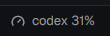

# AI provider usage

A quiet 28px status-bar block showing the busiest AI provider quota window, such as `codex 31%`,
after a gauge icon (Lucide `gauge`, 13px, `gauge.svg`). It uses the theme chrome background and top
border, muted text at the status bar's size (11.8px) and red at 90% or more. Hover to
see each available provider window and its reset time; providers needing login or unavailable are
listed once. No click action.



Configure the layout block's `content.props` with a command argv, optional machine and refresh in
seconds, for example:

```json
{ "command": ["node", "/path/to/kuota/collector/cli.js"], "on": "workstation", "every": 300 }
```

Use the absolute path to your own Kuota collector. Without `command`, the block is blank. `on`
selects the machine where the collector is installed; omit it for this computer. Refresh defaults to
300 seconds. The command is run directly, not through a shell; use paths rather than `~` expansion.
It must print Kuota schema-v2 JSON. A failure keeps the last good reading and adds a dim `!` with
the error in the tooltip; Herdr limits each execution to 30 seconds. Only one run may be in flight.

The pure parsing, busiest-window selection and reset formatting live in `logic.mjs`; test with
`node mods/usage/test_logic.mjs` and check the view with `herdr-app check mods/usage`.
