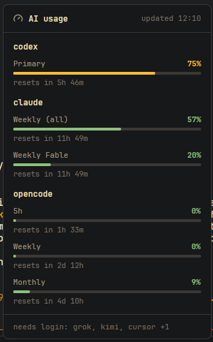

# AI provider usage

A quiet 28px status-bar block showing the busiest AI provider quota window, such as `codex 31%`,
after a gauge icon (Lucide `gauge`, 13px, `gauge.svg`). It uses the theme chrome background and top
border, muted text at the status bar's size (11.8px) and red at 90% or more. Hovering it
(250 ms) opens a card above it (`HoverCard` from `gpui-base`, anchored `bottom_center`, 300px wide):
a header with the gauge, **AI usage** and the time of the last update; then each provider with
numbers, busiest first, and under it one row per window: its label, the percent, a 4px bar and
"resets in 3h 12m". Bars and percents are green below 60%, yellow (`working`) below 85%, red
(`blocked`) from 85%. A footer names providers needing login or unavailable, three at most and
`+N`, and an update failure. Clicking the item updates it now ("updating…" in the card header meanwhile). When a quota window
first reaches 85%, a warning toast says so (`codex at 87%`, `Primary · resets in 2h 14m`), and again
in red at 95%; once per window per reset period, remembered in `localStorage`, and several at once
make one toast (`2 quotas above 85%`).



Configure the layout block's `content.props` with a command argv, optional machine and refresh in
seconds, for example:

```json
{ "command": ["node", "/path/to/kuota/collector/cli.js"], "on": "workstation", "every": 300 }
```

**Pinned providers** (optional `show`): instead of the busiest window, one item per provider in this
order, each an icon (else its name) and the percent of the window named, or its busiest window without
`window`; `—` while it reports none. Percents stay muted below 60%, then yellow and red. The hover card
is unchanged. Icons are paths under herdr-app's folder; `icons/<dir>/` loads (other folders didn't), e.g.

```json
"show": [{ "id": "claude", "window": "weekly-all", "icon": "icons/kuota/claude.png" },
         { "id": "codex", "window": "primary", "icon": "icons/kuota/codex.png" }]
```

Give the block room: about 60px per provider.

Use the absolute path to your own Kuota collector. Without flags it leaves out the browser-session
providers (mistral, muse, opendesign); add `"--enabled-providers=claude,codex,mistral"` (your own list)
to the argv to match what your Kuota widget shows. Without `command`, the block is blank. `on`
selects the machine where the collector is installed; omit it for this computer. Naming this computer
also runs it here, so one layout can be shared between machines. Refresh defaults to
300 seconds. The command is run directly, not through a shell; use paths rather than `~` expansion.
It must print Kuota schema-v2 JSON. A failure keeps the last good reading and adds a dim `!` with
the error in the card's footer; Herdr limits each execution to 30 seconds. Only one run may be in flight.

The pure parsing, busiest-window selection, card rows and reset formatting live in `logic.mjs`; test with
`node mods/usage/test_logic.mjs` and check the view with `herdr-app check mods/usage`.
